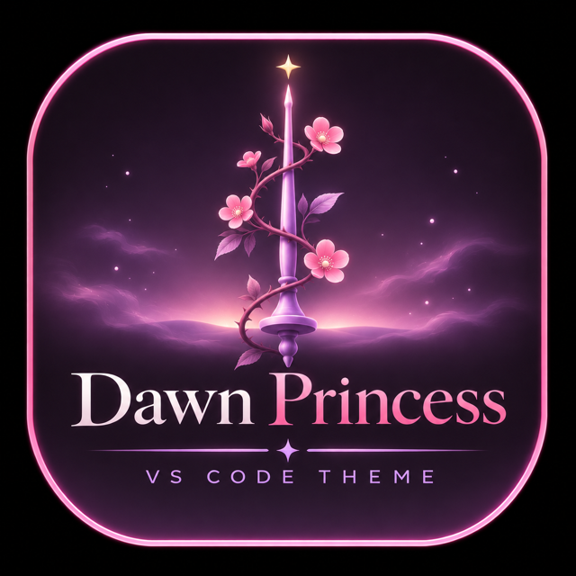

# Dawn Princess

<p align="center"></p>

A dark VS Code theme with a plum night sky, lilac dreams, rose dawn and a strand of golden light.

## Palette

<!-- palette:start -->
| Role | Color |
| --- | --- |
| Sidebar and panels | `#140f17` |
| Editor background | `#1b151e` |
| Menus, inputs and widgets | `#2a2131` |
| UI accent (selection, buttons, badges) | `#6b3f62` |
| Text | `#efe6ec` |
| Comments | `#958aa8` |
| Keywords, operators, tags | `#f08db4` |
| Functions, keys, attributes | `#cbaff0` |
| Strings | `#f5bfc4` |
| Types, numbers, cursor | `#b98de0` |
| Rare accent (this, regex, enum members) | `#f3d9b3` |
<!-- palette:end -->

## Install

Search for **Dawn Princess** in the Extensions view, or run:

```
code --install-extension thaisemanuele.dawn-princess
```
